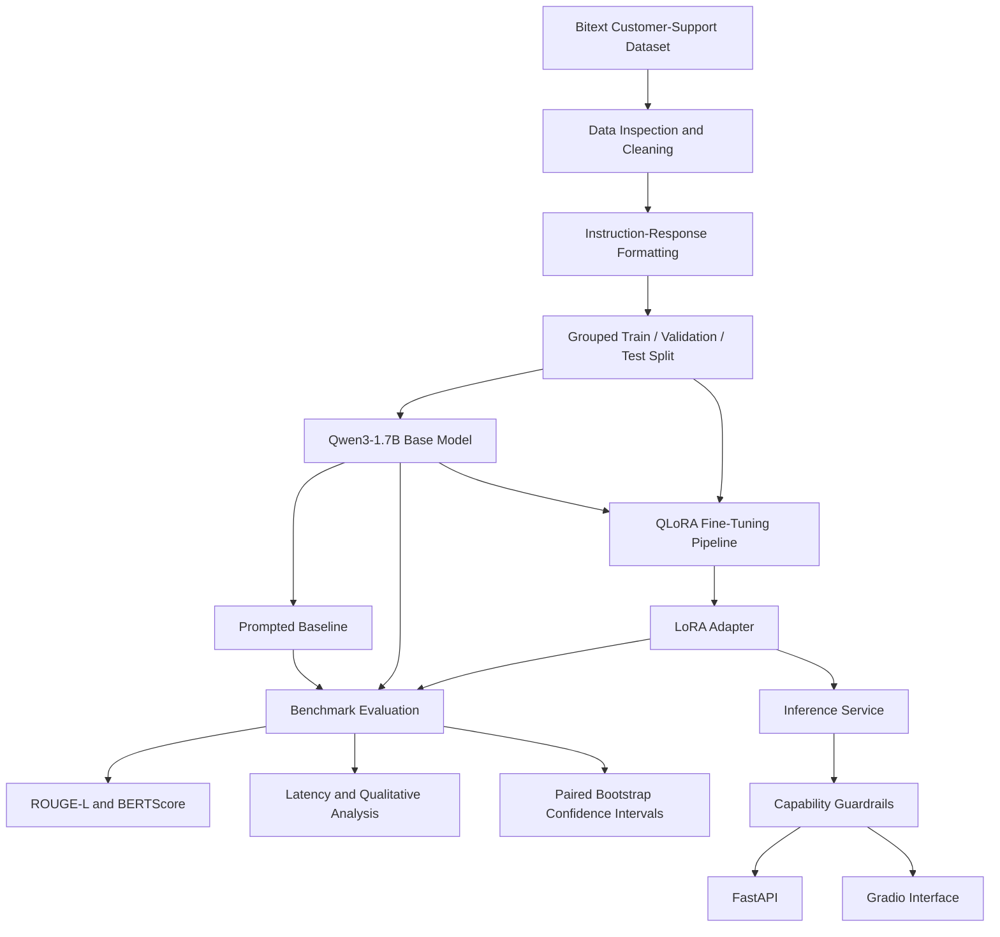
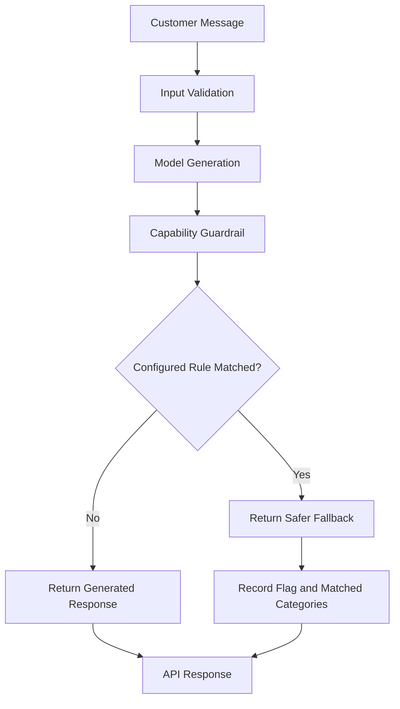

# NexaTune AI — Domain-Adaptive LLM Fine-Tuning & Evaluation Platform

**An end-to-end platform for fine-tuning, benchmarking, and serving domain-adapted language models for customer-support response generation.**

[](https://www.python.org/)
[](https://pytorch.org/)
[](https://huggingface.co/)
[](https://arxiv.org/abs/2305.14314)
[](https://fastapi.tiangolo.com/)
[](https://www.gradio.app/)


**Repository:** [Abhyang95/NexaTune-AI](https://github.com/Abhyang95/NexaTune-AI)

---

## Table of Contents

1. [Project Overview](#1-project-overview)
2. [Problem Statement](#2-problem-statement)
3. [Why Fine-Tuning?](#3-why-fine-tuning)
4. [Key Features](#4-key-features)
5. [System Architecture](#5-system-architecture)
6. [End-to-End Workflow](#6-end-to-end-workflow)
7. [Dataset Overview](#7-dataset-overview)
8. [Data Preparation](#8-data-preparation)
9. [Data Leakage Prevention](#9-data-leakage-prevention)
10. [Supervised Fine-Tuning](#10-supervised-fine-tuning)
11. [Training Configuration](#11-training-configuration)
12. [Evaluation Methodology](#12-evaluation-methodology)
13. [Benchmark Results](#13-benchmark-results)
14. [Statistical Validation](#14-statistical-validation)
15. [LLM-as-Judge Evaluation](#15-llm-as-judge-evaluation)
16. [Qualitative Failure Analysis](#16-qualitative-failure-analysis)
17. [Capability Guardrails](#17-capability-guardrails)
18. [FastAPI Inference API](#18-fastapi-inference-api)
19. [Gradio Interface](#19-gradio-interface)
20. [Project Structure](#20-project-structure)
21. [Local Setup](#21-local-setup)
22. [Running the Application](#22-running-the-application)
23. [Reproducible Benchmark](#23-reproducible-benchmark)
24. [Training Entry Point](#24-training-entry-point)
25. [Model Card](#25-model-card)
26. [Limitations](#26-limitations)
27. [Future Improvements](#27-future-improvements)
28. [Interview Preparation](#28-interview-preparation)
29. [Project Status](#29-project-status)

---

## 1. Project Overview

**NexaTune AI** is an end-to-end domain-adaptation platform that explores how parameter-efficient fine-tuning can improve an open-source language model's ability to generate customer-support responses.

The project fine-tunes `Qwen/Qwen3-1.7B-Base` using **QLoRA, LoRA, PEFT, and supervised fine-tuning (SFT)** on the Bitext customer-support conversation dataset.

Rather than relying only on qualitative examples, NexaTune AI includes a repeatable evaluation pipeline that compares the base model, a prompt-engineered baseline, and the fine-tuned model on a shared held-out benchmark.

The platform also includes a FastAPI inference service, a Gradio interface, response-generation guardrails, paired bootstrap confidence intervals, and qualitative failure analysis.

### Project at a glance

| Component | Implementation |
|---|---|
| Base model | `Qwen/Qwen3-1.7B-Base` |
| Training approach | Supervised fine-tuning with QLoRA |
| Adaptation method | LoRA through PEFT |
| Training dataset | Bitext customer-support conversations |
| Dataset size | 26,872 examples |
| Maximum sequence length | 512 tokens |
| Evaluation | ROUGE-L, BERTScore, latency, qualitative analysis |
| Statistical validation | Paired bootstrap confidence intervals |
| Inference API | FastAPI |
| User interface | Gradio |
| Final adapter | `models/final_adapter/` locally |
| Primary objective | Improve domain-specific response generation |

The platform is designed as a practical demonstration of the LLM development lifecycle: dataset analysis, leakage-aware splitting, parameter-efficient fine-tuning, benchmark construction, statistical evaluation, inference serving, and capability-aware response handling.

> **Important:** NexaTune AI is an experimental customer-support response-generation system. It does not connect to real customer accounts, payment processors, shipping systems, or order-management backends.

---

## 2. Problem Statement

General-purpose language models can produce fluent responses but may not consistently follow the response patterns expected in a specific domain.

In customer support, a useful response should be:

- Relevant to the customer's request.
- Clear, professional, and appropriately structured.
- Grounded in the information available to the model.
- Consistent with the intended support-response style.
- Careful not to invent account information, order updates, refunds, or actions that have not occurred.

Prompt engineering can guide a base model's behavior, but it does not necessarily teach the model a consistent domain-specific response distribution.

NexaTune AI investigates whether supervised fine-tuning with parameter-efficient adaptation can improve customer-support response quality, while measuring the trade-offs in inference latency and factual reliability.

### Project objectives

1. Prepare a structured customer-support dataset for supervised fine-tuning.
2. Prevent repeated instructions from leaking across training and evaluation splits.
3. Fine-tune a small open-source language model using QLoRA.
4. Compare the base model, prompted baseline, and fine-tuned model.
5. Quantify improvements using automatic metrics and paired statistical analysis.
6. Investigate response quality and factuality through qualitative review and AI-assisted judging.
7. Expose inference through a FastAPI service and a Gradio interface.
8. Add capability guardrails for responses that imply unsupported real-world actions.

---

## 3. Why Fine-Tuning?

NexaTune AI compares three approaches to customer-support response generation.

| Approach | Description | Purpose |
|---|---|---|
| Base model | Uses the pretrained model without domain-specific fine-tuning | Establishes the baseline |
| Prompted baseline | Uses an explicit support-oriented prompt with the base model | Measures the contribution of prompt engineering |
| NexaTune AI | Uses the fine-tuned model adapter | Measures the impact of domain adaptation |

### Why not use prompt engineering alone?

Prompt engineering can specify tone, response structure, and behavioral instructions. However, the model may still produce generic answers or inconsistent domain-specific responses.

Fine-tuning provides examples of the desired input-output behavior during training, allowing the model to adapt its response patterns to the target task.

### Why QLoRA?

Full fine-tuning updates all model parameters, requiring substantially more compute and memory.

QLoRA combines quantized base-model weights with trainable low-rank adapter parameters. This makes adaptation more practical on constrained GPU resources.

The project uses:

- **4-bit quantization:** Reduces the memory required to load the base model.
- **LoRA adapters:** Train a small subset of additional parameters rather than all base-model weights.
- **PEFT:** Manages parameter-efficient adaptation.
- **SFT:** Trains the model on customer-support instruction-response examples.

The objective is to improve domain-specific generation without the cost of full-parameter fine-tuning.

---

## 4. Key Features

### Data engineering

- Customer-support dataset inspection and analysis.
- Missing-value and duplicate analysis.
- Instruction-response formatting for supervised fine-tuning.
- Token-length analysis to inform sequence-length selection.
- Grouped train, validation, and test splits based on instruction identity.

### Model adaptation

- QLoRA-based fine-tuning of Qwen3-1.7B.
- 4-bit NF4 quantization.
- LoRA adapters managed through PEFT.
- Gradient accumulation and gradient checkpointing.
- Training entry points separated from module definitions.

### Evaluation and experimentation

- Base-versus-fine-tuned model benchmarking.
- Prompted-base comparison.
- ROUGE-L F1 and BERTScore F1.
- Generation latency and token-count measurements.
- Per-example prediction artifacts.
- Paired bootstrap confidence intervals.
- AI-assisted LLM-as-judge evaluation.
- Qualitative failure analysis.

### Inference and application layer

- FastAPI endpoints for health checks, model information, and text generation.
- Gradio interface for interactive experimentation.
- Input validation.
- Capability guardrails for unsupported commitments and actions.
- Logging and structured response metadata.

---

## 5. System Architecture

The following diagram summarizes the main pipeline from data preparation to inference.



### Architectural layers

| Layer | Responsibility |
|---|---|
| Data layer | Inspect, clean, split, and format customer-support examples |
| Training layer | Load the base model and perform QLoRA-based SFT |
| Adaptation layer | Store the trained LoRA adapter separately from base weights |
| Evaluation layer | Compare model variants on a fixed held-out benchmark |
| Statistical layer | Quantify uncertainty in paired metric differences |
| Inference layer | Generate responses using the base model and adapter |
| Safety layer | Flag responses that may imply unsupported capabilities |
| Application layer | Expose model functionality through FastAPI and Gradio |

The adapter is a lightweight set of learned parameters applied to the base model. It is not a complete standalone replacement for the original model weights.

---

## 6. End-to-End Workflow

NexaTune AI is organized into a reproducible workflow rather than a single training script.

1. **Inspect the dataset:** Examine schema, missing values, repeated instructions, and response lengths.
2. **Prepare examples:** Convert the source records into a consistent instruction-response format.
3. **Prevent leakage:** Group examples by instruction before assigning train, validation, and test partitions.
4. **Analyze tokens:** Examine token-length distributions and choose a maximum sequence length.
5. **Configure the model:** Load Qwen3-1.7B using 4-bit quantization and configure LoRA.
6. **Fine-tune:** Train the adapter on the training split while monitoring validation performance.
7. **Benchmark:** Generate responses for a fixed held-out evaluation set using the base, prompted-base, and fine-tuned variants.
8. **Measure performance:** Calculate automatic text-similarity metrics, latency, and generation statistics.
9. **Quantify uncertainty:** Estimate paired bootstrap confidence intervals for metric differences.
10. **Analyze failure modes:** Review examples involving unsupported claims, factuality, and customer-support behavior.
11. **Serve the model:** Expose inference through FastAPI and an interactive Gradio interface.
12. **Apply guardrails:** Detect selected unsupported capability claims and return safer fallback responses when appropriate.

This separation makes it easier to reproduce experiments, inspect model behavior, and change one stage without unnecessarily coupling the rest of the pipeline.

---

## 7. Dataset Overview

NexaTune AI uses the public [Bitext Customer Support LLM Chatbot Training Dataset](https://huggingface.co/datasets/bitext/Bitext-customer-support-llm-chatbot-training-dataset).

### Dataset characteristics

| Property | Value |
|---|---:|
| Total examples | 26,872 |
| Customer-support intents | 27 |
| Missing values found in inspected fields | 0 |
| Repeated instructions | 2,237 |
| Exact duplicate instruction-response pairs | 0 |
| Maximum analyzed token length | 502 |
| Configured maximum sequence length | 512 |

The inspected dataset contains fields such as:

- `flags`
- `instruction`
- `category`
- `intent`
- `response`

The `instruction` field represents the customer request, while `response` provides the target support response. The category and intent fields help characterize the task distribution.

### Why dataset inspection matters

Before training, dataset inspection helps identify:

- Missing or malformed examples.
- Repeated prompts that could bias the evaluation.
- Long examples that may be truncated.
- Uneven intent coverage.
- Potential problems with the input-output format.

Repeated instructions are not automatically invalid. The same customer request can have multiple valid responses. Therefore, duplicate handling should distinguish between repeated instructions and exact duplicate instruction-response pairs.

---

## 8. Data Preparation

The data preparation pipeline converts the raw dataset into a consistent representation suitable for supervised fine-tuning.

### Preparation stages

1. Load and inspect the dataset.
2. Validate required fields.
3. Check missing values and duplicate records.
4. Analyze token lengths.
5. Assign examples to train, validation, and test splits.
6. Format customer requests and target responses into the model's training format.
7. Save processed datasets for training and evaluation.

### Dataset partitioning

The project uses a grouped split based on instruction identity.

| Partition | Examples |
|---|---:|
| Training | 21,500 |
| Validation | 2,713 |
| Test | 2,659 |
| **Total** | **26,872** |

The partitions are designed so repeated instructions do not cross between training and evaluation sets.

This is important because a conventional random row-level split could place the same instruction in both training and testing, potentially inflating evaluation results.

### Token-length analysis


NexaTune intentionally focuses on **model adaptation rather than retrieval**.

This gives the project a different role from a separate RAG/agentic project in the portfolio.

A production customer-support system could combine both:

```text
Fine-Tuned Model
      +
RAG / Knowledge Base
      +
Tools / APIs
      +
Guardrails
```

# End-to-End Workflow

```text
Dataset
  ↓
Data inspection
  ↓
Cleaning + exact-pair deduplication
  ↓
Instruction-grouped train / validation / test split
  ↓
SFT formatting
  ↓
Token-length analysis
  ↓
Base-model benchmark
  ↓
QLoRA configuration
  ↓
Cloud GPU training
  ↓
Checkpoint persistence
  ↓
Checkpoint recovery
  ↓
Final LoRA adapter
  ↓
Deterministic benchmark
  ↓
Bootstrap confidence intervals
  ↓
Prompted baseline
  ↓
AI-assisted LLM-as-judge evaluation
  ↓
Qualitative failure analysis
  ↓
FastAPI inference
  ↓
Capability guardrails
  ↓
Gradio UI
```

---

# Dataset

**Dataset:**

```text
bitext/Bitext-customer-support-llm-chatbot-training-dataset
```

Original dataset size:

```text
26,872 examples
```

Columns:

```text
flags
instruction
category
intent
response
```

The dataset contains customer-support categories including:

* ACCOUNT
* ORDER
* REFUND
* INVOICE
* CONTACT
* PAYMENT
* FEEDBACK
* DELIVERY
* SHIPPING
* SUBSCRIPTION
* CANCEL

The dataset contains 27 customer-support intents.

---

# Data Preparation

## Data Quality

| Check                                | Result |
| ------------------------------------ | -----: |
| Total examples                       | 26,872 |
| Missing values                       |      0 |
| Duplicate instructions               |  2,237 |
| Duplicate instruction-response pairs |      0 |

The dataset contains repeated customer instructions with different valid responses.

Therefore, deduplication was performed using the **exact instruction-response pair** rather than removing every repeated instruction.

---

# Leakage Prevention

A major evaluation concern was preventing identical customer instructions from appearing across different splits.

The dataset was split at the **instruction-group level**.

This means that all examples belonging to the same instruction group remain within the same split.

Final split:

| Split      |   Examples |
| ---------- | ---------: |
| Train      |     21,500 |
| Validation |      2,713 |
| Test       |      2,659 |
| **Total**  | **26,872** |

This prevents an identical customer instruction from appearing in both training and evaluation data.

---

# SFT Formatting

Examples were converted into a consistent customer-support conversation format:

```text
Customer:
{instruction}

Assistant:
{response}
```

This format is used during supervised fine-tuning and benchmark generation.

---

# Token Analysis

Token-length analysis was performed before selecting the training sequence length.


The inspected token-length distribution is:


| Statistic | Tokens |
|---|---:|
| Mean | 140.95 |
| Median | 119 |
| 90th percentile | 233 |
| 95th percentile | 275 |
| 99th percentile | 380 |
| Maximum | 502 |

The configured maximum sequence length is **512 tokens**, which accommodates the maximum observed length in the analyzed examples under the reported tokenization setup.

If the tokenizer, prompt template, or formatting changes, token lengths should be re-evaluated because those changes can affect truncation.

---

## 9. Data Leakage Prevention

Data leakage occurs when information from the evaluation set influences training or model selection in a way that makes reported performance overly optimistic.

A key risk in customer-support datasets is that the same instruction can occur multiple times with different or similar target responses.

### Potential problem with random row-level splitting

Suppose a dataset contains several examples of the same instruction:

- "Where can I find my invoice?"
- "Where can I find my invoice?"
- "Where can I find my invoice?"

If these examples are randomly assigned to different partitions, the model may encounter the same request during training and evaluation.

Even when the target responses differ, the repeated instruction can make the test task less independent.

### Project approach

NexaTune AI groups records by instruction identity before splitting them into training, validation, and test partitions.

The objective is to ensure that a repeated instruction remains within one partition.

This supports a more meaningful comparison between model variants because evaluation examples are less likely to be near-duplicates of the instructions used for training.

**Important distinction:** Grouping by instruction reduces this specific leakage risk. It does not eliminate every possible form of semantic overlap or guarantee that the dataset is free of all leakage.

---

## 10. Supervised Fine-Tuning

The project adapts `Qwen/Qwen3-1.7B-Base` to customer-support response generation through supervised fine-tuning.

Each training example provides an input representing a customer request and a target response representing the desired answer.

The training objective is to optimize the model to generate the target response conditioned on the input.

### Fine-tuning approach

The implementation uses:

- Hugging Face Transformers for model loading and generation.
- PEFT for parameter-efficient adapter configuration.
- QLoRA for memory-efficient fine-tuning.
- TRL's `SFTTrainer` for supervised fine-tuning.
- bitsandbytes for 4-bit quantization.

### LoRA configuration

The main adapter configuration uses:

| Parameter | Value |
|---|---|
| LoRA rank (`r`) | 16 |
| LoRA alpha | 32 |
| LoRA dropout | 0.05 |
| Target modules | `q_proj`, `k_proj`, `v_proj`, `o_proj` |
| Quantization | 4-bit NF4 |
| Double quantization | Enabled |
| Compute precision | FP16 |
| Maximum sequence length | 512 |

LoRA introduces trainable low-rank matrices into selected model projections. Instead of updating the full base model, optimization focuses on the adapter parameters.

The selected attention projection modules allow the adaptation process to modify aspects of attention behavior while retaining the pretrained base weights.

---

## 11. Training Configuration

The final cloud training run used a T4 GPU.

| Setting | Value |
|---|---|
| Base model | `Qwen/Qwen3-1.7B-Base` |
| Training method | QLoRA + LoRA + SFT |
| Epochs | 1 |
| Learning rate | 0.0002 |
| Weight decay | 0.01 |
| Warmup steps | 100 |
| Per-device training batch size | 1 |
| Per-device evaluation batch size | 1 |
| Gradient accumulation steps | 8 |
| Effective batch size | 8, assuming one device |
| Maximum sequence length | 512 |
| Gradient checkpointing | Enabled |
| Random seed | 42 |

### Parameter efficiency

The reported model parameter counts are:

| Metric | Value |
|---|---:|
| Total model parameters | 1,726,997,504 |
| Trainable parameters | 6,422,528 |
| Trainable parameter percentage | 0.3719% |
| Approximate adapter size | 24.5 MB |

Only a small fraction of the total model parameters is trainable. This reduces training memory requirements and produces a compact adapter artifact.

The adapter is stored separately from the base model. Loading the fine-tuned model therefore requires both the compatible base model and the trained adapter.

### Hardware and training recovery

The local development environment used an NVIDIA GTX 1650 with 4 GB VRAM. The training configuration and trainer construction were validated locally, but a full training run was too slow for the local hardware.

The final cloud training run used a T4 GPU. Training was recovered after a cloud-session interruption by transferring checkpoint `checkpoint-1250` to a Kaggle dataset and resuming training there.

The training code separates trainer construction from execution:

- `build_trainer()` constructs and returns the `SFTTrainer`.
- `run_training.py` invokes `trainer.train()` and saves the final adapter.
- Importing the training modules does not automatically start a training run.

This separation improves testability and reduces the risk of unintentionally launching expensive training when importing a module.
---

## 12. Evaluation Methodology

Fine-tuning alone does not establish that a model has improved. NexaTune AI uses a comparative evaluation pipeline to measure response similarity, semantic quality, latency, and selected behavioral risks.

### Models compared

| Model | Description |
|---|---|
| Base model | Original `Qwen/Qwen3-1.7B-Base` without domain-specific fine-tuning |
| Prompted baseline | Base model with a customer-support-oriented prompt |
| NexaTune AI | Base model combined with the trained LoRA adapter |

All three approaches are evaluated against the same fixed set of 100 held-out examples.

### Evaluation configuration

| Setting | Value |
|---|---|
| Held-out benchmark size | 100 examples |
| Benchmark selection | Test split, shuffled with seed 42 |
| Generation mode | Deterministic decoding |
| Sampling | Disabled (`do_sample=False`) |
| Maximum new tokens | 128 |
| Text-overlap metric | ROUGE-L F1 |
| Semantic similarity metric | BERTScore F1 |
| Performance measurements | Average and median latency |
| Additional analysis | Generated token counts, paired examples, qualitative review |

Using the same examples for each model makes the comparisons paired: each model answers the same customer requests.

Deterministic decoding reduces generation variability for a fixed model, prompt, and software configuration. It does not guarantee identical outputs across different hardware, library versions, or inference implementations.

### Evaluation metrics

**ROUGE-L F1**

Measures overlap based on the longest common subsequence between the generated response and reference response. It provides a signal about wording and response structure, but it is not a complete measure of correctness.

**BERTScore F1**

Measures semantic similarity using contextual token representations. It can recognize some semantically similar wording that exact lexical metrics miss. However, semantic similarity does not guarantee factual accuracy.

**Latency**

Measures the time taken to generate a response under the benchmark setup. Latency depends on hardware, sequence lengths, model loading, and the inference implementation.

**Generated token count**

Helps interpret latency and response length. Similar token counts do not necessarily imply similar response quality.

No single metric is sufficient to evaluate a customer-support language model. The project combines automatic metrics with statistical uncertainty estimates and qualitative failure analysis.

---

## 13. Benchmark Results

The canonical benchmark compares the base model against the fine-tuned NexaTune AI model on the same 100 held-out examples.

### Base model vs. NexaTune AI

| Metric | Base model | NexaTune AI | Change |
|---|---:|---:|---:|
| ROUGE-L F1 | 0.2120 | 0.4082 | +0.1962 |
| BERTScore F1 | 0.8574 | 0.9160 | +0.0586 |
| Average latency | 9.22 s | 15.45 s | +67.6% |
| Median latency | 10.95 s | 15.22 s | +38.9% |
| Average generated tokens | 100.1 | 99.9 | -0.2 |

<text>**Interpretation:** The fine-tuned model improved both reported automatic similarity metrics, while generation took longer under the measured benchmark configuration.</text>

The ROUGE-L F1 score increased from 0.2120 to 0.4082, an absolute improvement of 0.1962. The BERTScore F1 score increased from 0.8574 to 0.9160, an absolute improvement of 0.0586.

The average generated token count remained nearly unchanged, suggesting that the latency difference cannot be explained simply by the fine-tuned model producing substantially longer responses. Differences in inference implementation, adapter overhead, hardware utilization, and other runtime factors may also contribute.

### How should these results be interpreted?

- **Response similarity improved:** The fine-tuned model's outputs more closely matched the reference responses according to the two reported metrics.
- **Latency increased:** The measured configuration has a runtime cost that should be considered before deployment.
- **Factuality still requires separate assessment:** Higher ROUGE-L or BERTScore does not prove that a response is factually correct or safe.
- **The benchmark is small:** Results from 100 examples are useful for experimentation but do not establish production-level reliability or broad generalization.

### Prompted baseline

The prompted-base model is included to distinguish the effect of prompt engineering from the effect of fine-tuning.

Its prediction and metric artifacts are stored separately from those of the base and fine-tuned models. The paired statistical results comparing the prompted baseline with NexaTune AI are presented in the next section.

---

## 14. Statistical Validation

A difference between two benchmark scores can arise partly from the specific evaluation examples selected. NexaTune AI therefore uses paired bootstrap resampling to estimate uncertainty around the observed metric differences.

### Methodology

The evaluation procedure:

1. Uses paired predictions from the same 100 held-out examples.
2. Resamples the paired examples with replacement.
3. Recalculates the metric difference for each resample.
4. Repeats the procedure 10,000 times.
5. Uses the 2.5th and 97.5th percentiles of the bootstrap distribution as a 95% percentile confidence interval.

The bootstrap random seed is 42.

### Base model vs. NexaTune AI

| Metric difference | Observed difference | 95% bootstrap CI |
|---|---:|---:|
| ROUGE-L F1 | +0.1962 | [0.1751, 0.2185] |
| BERTScore F1 | +0.0585 | [0.0535, 0.0638] |

The reported intervals are above zero, indicating that the measured metric improvements were consistent across the paired bootstrap resamples for this benchmark.

### Prompted baseline vs. NexaTune AI

| Metric difference | Observed difference | 95% bootstrap CI |
|---|---:|---:|
| ROUGE-L F1 | +0.1854 | [0.1639, 0.2074] |
| BERTScore F1 | +0.0485 | [0.0436, 0.0535] |

These results suggest that NexaTune AI improved the reported text-similarity metrics beyond the prompted baseline on the selected benchmark.

### Important statistical caveats

- A bootstrap confidence interval describes uncertainty under the resampling procedure and observed sample; it does not correct dataset bias.
- The 100-example benchmark is relatively small and may not represent the full distribution of real customer-support requests.
- ROUGE-L and BERTScore are proxy metrics, not direct measurements of customer satisfaction or factual correctness.
- A bootstrap estimate of the probability that a difference is positive is **not** a conventional hypothesis-test p-value.
- Statistical evidence for a metric improvement does not establish that the model is ready for production.

### Reproducibility

The benchmark artifacts are stored under `results/benchmark/`, including:

- `base_predictions.json`
- `prompted_base_predictions.json`
- `finetuned_predictions.json`
- `benchmark_metrics.json`
- `prompted_base_metrics.json`
- `bootstrap_ci.json`

These artifacts support inspection of individual outputs as well as the aggregated evaluation results.

---

## 15. AI-Assisted LLM-as-Judge Evaluation

Automatic text-similarity metrics do not capture every aspect of response quality. NexaTune AI therefore includes an exploratory AI-assisted evaluation of 30 examples.

The evaluation compares base-model responses with NexaTune AI responses across several quality dimensions.

**This is an LLM-as-judge experiment, not a human evaluation study.** Judge-generated scores can be affected by rubric design, model bias, prompt sensitivity, and inconsistent judgments.

### Results

| Evaluation dimension | Base model | NexaTune AI | Difference |
|---|---:|---:|---:|
| Correctness | 3.50 | 3.83 | +0.33 |
| Relevance | 4.10 | 4.57 | +0.47 |
| Helpfulness | 3.43 | 3.97 | +0.53 |
| Professionalism | 4.30 | 4.60 | +0.30 |
| Factuality | 4.37 | 3.33 | -1.03 |
| Overall score | 3.94 | 4.06 | +0.12 |

*Scores use the evaluation rubric's reported scale.*

### Overall preference

| Preference outcome | Examples | Percentage |
|---|---:|---:|
| Preferred NexaTune AI | 13 | 43.3% |
| Preferred base model | 12 | 40.0% |
| Tie | 5 | 16.7% |
| **Total** | **30** | **100%** |

### Key findings

NexaTune AI received higher judge scores for correctness, relevance, helpfulness, professionalism, and overall quality. However, the judge assigned it a substantially lower factuality score.

The overall score difference was small, and its reported confidence interval was approximately `[-0.21, +0.49]`, crossing zero. The results therefore do not establish a statistically reliable overall preference for the fine-tuned model.

The factuality result is especially important. A model can produce more polished and relevant responses while also making unsupported claims. This reinforces the need to evaluate factuality and capability boundaries independently of fluency and similarity metrics.

### Limitations of the judge experiment

- Only 30 examples were evaluated.
- The judgments were generated by an AI judge rather than independent human raters.
- The result depends on the judge model, rubric, and evaluation prompts.
- The evaluation is exploratory and should not be interpreted as a definitive measure of real-world customer satisfaction.

A larger evaluation with independent human raters and multiple judge models would provide stronger evidence.

---

## 16. Qualitative Failure Analysis

NexaTune AI includes qualitative inspection because numerical metrics can hide important differences in model behavior.

### Failure patterns observed

**1. Unsupported transactional claims**

The base model sometimes generated payment or invoice links that were not grounded in the available input.

**2. Invented order information**

Responses could include unsupported tracking numbers, dates, or shipping-status updates.

**3. Unsupported resolution claims**

The model sometimes stated or implied that a shipping problem had been resolved even though it had no access to a real order-management system.

**4. Implied backend capabilities**

The fine-tuned model improved several response-quality dimensions but could still imply that it had initiated a refund, contacted a human agent, or performed another action that was not actually available.

### Example of the problem

A customer asks for an update on an order, but the model has no connection to a shipping system.

An unsafe response might invent a tracking number or claim that the order is arriving tomorrow. A safer response should explain that it cannot verify the order status and direct the customer to an appropriate official channel.

### Why this matters

Customer-support language models must distinguish between:

- Explaining a process.
- Providing information supplied in the conversation.
- Claiming that an external action has occurred.
- Actually executing an action through an authorized system.

A model that explains refund procedures is not equivalent to a model that can process a refund.

The observed factuality regression is a reason to treat fine-tuning as one part of the system rather than as a substitute for validation, grounded retrieval, backend authorization, and safe application design.

---

## 17. Capability Guardrails

NexaTune AI includes a post-generation guardrail layer that detects selected categories of unsupported commitments or action claims.

The guardrail examines generated text for configured patterns. When a response triggers a rule, the system can return a safer replacement response while retaining information about the original generated output for traceability.

### Guardrail categories

| Category | Purpose |
|---|---|
| `HUMAN_HANDOFF` | Detects claims that imply a human agent has been contacted or that a handoff has occurred |
| `REFUND_ACTION` | Detects claims that imply a refund has been issued or processed |
| `ORDER_CANCELLATION` | Detects claims that imply an order has been cancelled |
| `BACKEND_ACTION` | Detects selected claims that an external operation has been performed |
| `UNSUPPORTED_COMMITMENT` | Detects selected unsupported promises or commitments |

### Response flow



### Guardrail behavior

The API response can include:

- The returned response.
- Whether a guardrail rule was triggered.
- The matched rules or categories.
- The original generated response when available for traceability.

The original response should be handled carefully because it may contain unsupported or misleading claims.

### Limitations

These guardrails are rule-based safeguards, not a complete safety system.

They may miss unsupported claims phrased in unexpected ways, and they may flag benign wording. They do not verify external facts, authorize transactions, or prove that an action actually occurred.

A production implementation would need broader testing, stronger grounding, backend authorization, and monitoring of false positives and false negatives.

---

## 18. FastAPI Inference API

NexaTune AI exposes model inference through a FastAPI service.

### Available endpoints

| Method | Endpoint | Purpose |
|---|---|---|
| `GET` | `/health` | Check API health |
| `GET` | `/model-info` | Retrieve model and inference metadata |
| `POST` | `/generate` | Generate a customer-support response |

### Input validation

The generation endpoint validates the submitted customer message. The configured accepted message length is **1–4,000 characters**.

Requests outside the permitted range should be rejected rather than passed directly to the model.

### Example request

```http
POST /generate
Content-Type: application/json
```

```json
{
  "message": "How can I get a copy of my invoice?"
}
```

### Example response shape

```json
{
  "response": "You can usually find your invoice in the order confirmation or account order details. If you cannot locate it, check the seller's official support channel.",
  "model": "NexaTune-Qwen3-1.7B",
  "guardrail_flagged": false,
  "guardrail_matches": [],
  "guardrail_categories": [],
  "original_response": null
}
```

*The response above illustrates the API response structure; the exact generated wording and metadata depend on the request and model output.*

### Health check

Once the API is running locally, check:

```text
http://127.0.0.1:8000/health
```

### Model information

The model metadata endpoint is available at:

```text
http://127.0.0.1:8000/model-info
```

### API design considerations

The service separates request validation, inference, and guardrail processing. This makes the system easier to inspect and extend than a single function that combines all three responsibilities.

The API is intended for local experimentation and demonstration. Authentication, rate limiting, production deployment controls, and comprehensive observability remain separate hardening tasks.

---

## 19. Gradio Interface

NexaTune AI includes a Gradio interface for interactive experimentation with customer-support response generation.

The interface provides a convenient way to submit a message and inspect the generated response without manually constructing API requests.

### Launching the interface

The Gradio application is defined in:

```text
app/gradio_app.py
```

When launched with the configuration described in the setup section, the local interface is available at:

```text
http://127.0.0.1:7860
```

The interface communicates with the inference service rather than independently implementing the training or model-adaptation pipeline.

### Why include both FastAPI and Gradio?

- **FastAPI** provides a structured HTTP interface for integration and automated testing.
- **Gradio** provides a convenient human-facing interface for interactive experiments.
- **Shared inference logic** helps keep model behavior consistent across application entry points.

The UI and API are development interfaces. Their availability on a local machine does not imply that a public deployment is hosted.
---

## 20. Project Structure

The repository separates data preparation, model training, evaluation, inference, and application serving into distinct modules.

```text
NexaTune-AI/
├── api/
│   ├── __init__.py
│   ├── capability_guardrail.py
│   ├── inference_service.py
│   ├── logging_config.py
│   ├── main.py
│   └── schemas.py
├── app/
│   └── gradio_app.py
├── configs/
│   └── llm_judge_rubric.json
├── data/
│   └── processed/
│       ├── customer_support/
│       └── customer_support_sft/
├── models/
│   └── final_adapter/
│       └── [local adapter artifacts]
├── notebooks/
├── outputs/
├── results/
│   ├── baseline/
│   └── benchmark/
│       ├── base_predictions.json
│       ├── benchmark_metrics.json
│       ├── bootstrap_ci.json
│       ├── finetuned_predictions.json
│       ├── human_eval_set.json
│       ├── human_evaluation.xlsx
│       ├── prompted_base_metrics.json
│       └── prompted_base_predictions.json
├── src/
│   ├── data/
│   │   ├── analyze_tokens.py
│   │   ├── download_dataset.py
│   │   ├── format_sft.py
│   │   ├── inspect_dataset.py
│   │   └── prepare_dataset.py
│   ├── evaluation/
│   │   ├── baseline_eval.py
│   │   ├── bootstrap_ci.py
│   │   ├── compare_models.py
│   │   ├── create_eval_set.py
│   │   ├── create_human_eval_sheet.py
│   │   ├── metrics.py
│   │   ├── prompted_baseline.py
│   │   └── run_benchmark.py
│   ├── inference/
│   │   ├── generate_response.py
│   │   ├── model.py
│   │   └── test_qwen.py
│   ├── training/
│   │   ├── config.py
│   │   ├── run_training.py
│   │   └── train_qlora.py
│   └── system_check.py
├── .gitignore
├── README.md
└── requirements.txt
```

*Note: This is the documented project layout. The exact files available in a particular checkout may differ. Adapter weights and generated artifacts may be excluded from Git.*

### Module responsibilities

| Directory | Responsibility |
|---|---|
| `src/data/` | Dataset inspection, preparation, formatting, and token analysis |
| `src/training/` | QLoRA configuration and supervised fine-tuning |
| `src/evaluation/` | Benchmarking, metrics, baseline comparisons, and bootstrap analysis |
| `src/inference/` | Model loading and response generation |
| `api/` | FastAPI endpoints, inference service, schemas, and guardrails |
| `app/` | Gradio user interface |
| `configs/` | Evaluation rubric configuration |
| `results/` | Benchmark predictions, metrics, and evaluation artifacts |
| `models/` | Local model-adapter artifacts |

---

## 21. Local Setup

### Prerequisites

- Python 3.11 recommended.
- Git.
- A compatible PyTorch installation.
- Sufficient memory for the selected base model and inference configuration.
- A compatible GPU is recommended for practical inference and training performance.

Training and inference have different resource requirements. The final adapter is small, but inference still requires loading the base model. Full training may be impractical on a low-memory GPU.

### Step 1: Clone the repository

```bash
git clone https://github.com/Abhyang95/NexaTune-AI.git
cd NexaTune-AI
```

### Step 2: Create a virtual environment

On Windows PowerShell:

```powershell
python -m venv .venv
.\.venv\Scripts\Activate.ps1
```

If PowerShell blocks script execution, use the activation approach permitted by your system policy or activate the environment through your IDE.

### Step 3: Install dependencies

```bash
python -m pip install --upgrade pip
pip install -r requirements.txt
```

For GPU workloads, ensure that the installed PyTorch and bitsandbytes versions are compatible with your operating system, GPU, and CUDA environment.

### Step 4: Obtain the model adapter

The fine-tuned adapter is expected at:

```text
models/final_adapter/
```

The adapter may not be included in the GitHub repository because model binaries are excluded by `.gitignore`.

If the adapter is stored elsewhere, configure its path using the environment variable expected by the application:

```powershell
$env:NEXATUNE_ADAPTER_PATH="C:\path\to\final_adapter"
```

Replace the example path with the actual location of the adapter artifacts. Confirm that the directory contains the required adapter configuration and weight files.

### Step 5: Verify the environment

Run the repository's system-check utility:

```bash
python -m src.system_check
```

The exact checks depend on the current implementation. Resolve missing packages, model access issues, incompatible versions, or missing adapter files before starting inference.

---

## 22. Running the Application

NexaTune AI separates the inference API, interactive interface, training pipeline, and benchmark commands.

### Start the FastAPI server

From the repository root:

```bash
uvicorn api.main:app --reload
```

The API should be available at:

```text
http://127.0.0.1:8000
```

FastAPI's interactive documentation is normally available at:

```text
http://127.0.0.1:8000/docs
```

### Start the Gradio interface

Open a second terminal, activate the virtual environment, and run:

```bash
python app/gradio_app.py
```

The interface is configured for local access at:

```text
http://127.0.0.1:7860
```

### Check the API

Open the health endpoint:

```text
http://127.0.0.1:8000/health
```

Then inspect model metadata:

```text
http://127.0.0.1:8000/model-info
```

If the server starts but generation fails, check the configured adapter path, model-loading logs, GPU memory, and package compatibility.

### Troubleshooting

| Issue | What to check |
|---|---|
| Adapter not found | Confirm the local adapter path and `NEXATUNE_ADAPTER_PATH` configuration |
| CUDA out-of-memory | Reduce memory usage, check other GPU processes, or use a compatible lower-memory configuration |
| Slow CPU inference | CPU inference may be substantially slower than GPU inference |
| Missing Python package | Install the compatible project dependencies |
| API starts but generation fails | Inspect inference logs and model-loading errors |
| Gradio cannot reach the API | Confirm that FastAPI is running at the address configured by the interface |
| Training restarts unexpectedly | Inspect checkpoint-resume settings and the training entry point |

---

## 23. Reproducible Benchmark

The evaluation pipeline compares the base model, prompted baseline, and fine-tuned model using a fixed held-out set.

Run the benchmark from the repository root:

```bash
python -m src.evaluation.run_benchmark
```

The command requires the dependencies, model access, and adapter configuration used by the evaluation implementation.

### Expected evaluation artifacts

```text
results/
└── benchmark/
    ├── base_predictions.json
    ├── prompted_base_predictions.json
    ├── finetuned_predictions.json
    ├── benchmark_metrics.json
    ├── prompted_base_metrics.json
    └── bootstrap_ci.json
```

The benchmark predictions make it possible to inspect individual examples instead of relying exclusively on aggregate scores.

### Recommended reproducibility checklist

- Use the same held-out examples for all compared models.
- Keep generation settings consistent wherever the comparison requires them.
- Record the model and tokenizer revisions.
- Record dependency versions and hardware details.
- Preserve the benchmark's random seed and example identifiers.
- Recalculate metrics from the saved predictions when validating results.
- Keep automatic metrics, judge evaluations, and human evaluations clearly distinguished.

A fixed seed helps reproduce example selection and resampling, but it does not guarantee identical results across every hardware and software configuration.

---

## 24. Training Entry Point

The training pipeline separates configuration, trainer construction, training execution, and adapter saving.

### Training command

```bash
python -m src.training.run_training
```

The training entry point is responsible for executing the training process and saving the resulting adapter.

### Separation of responsibilities

| Component | Responsibility |
|---|---|
| `src/training/config.py` | Training configuration |
| `src/training/train_qlora.py` | Model and trainer construction |
| `src/training/run_training.py` | Training execution and final saving |

The `build_trainer()` function constructs and returns the `SFTTrainer`. The training entry point invokes `trainer.train()` and saves the final adapter.

Importing the training modules does not itself start training.

### Training considerations

- Training can be expensive in time and GPU memory.
- The base model must be accessible to the training environment.
- Checkpoint recovery requires compatible checkpoint files and configuration.
- The saved adapter must be compatible with the base model and tokenizer setup used during inference.
- Training should be rerun when changes to the dataset, formatting, or model configuration require a new experiment.

---

## 25. Model Card

### Model details

| Field | Description |
|---|---|
| Project | NexaTune AI |
| Base model | `Qwen/Qwen3-1.7B-Base` |
| Adaptation | QLoRA with LoRA adapters |
| Training objective | Supervised fine-tuning |
| Domain | Customer-support response generation |
| Dataset | Bitext customer-support conversation dataset |
| Intended use | Research, experimentation, and portfolio demonstration |

### Intended uses

NexaTune AI is intended for:

- Experimentation with parameter-efficient fine-tuning.
- Comparing base, prompted, and fine-tuned language models.
- Studying domain-specific response generation.
- Demonstrating model evaluation and statistical analysis.
- Testing inference APIs and interactive LLM applications.
- Exploring capability-aware response handling.

### Out-of-scope uses

The system is not an authoritative:

- Customer account system.
- Payment processor.
- Order-management or shipment-tracking service.
- Refund or cancellation execution service.
- Human-agent handoff service.
- Source of verified customer account information.
- Autonomous transactional system.

### Safety and reliability considerations

The model can produce incorrect, incomplete, or unsupported claims. Its responses should not be treated as verified facts about real customers, payments, orders, or account activity.

The post-generation guardrails detect selected patterns but do not guarantee correctness or safety. They are not a replacement for external data validation, authenticated backend operations, or human review.

### Deployment recommendation

Before using the model in a real customer-support workflow, conduct a larger evaluation with representative data, independent human raters, adversarial cases, factuality checks, and explicit backend authorization controls.

---

## 26. Limitations

NexaTune AI is an experimental fine-tuning and evaluation project. Several limitations should be considered when interpreting the results.

### 1. Small benchmark

The main automatic benchmark uses 100 held-out examples. This is useful for a controlled experiment but is not sufficient to establish broad production reliability.

### 2. AI-assisted judging

The LLM-as-judge analysis covers 30 examples. Judge scores can be affected by the evaluator model and rubric and should not be treated as equivalent to independent human evaluation.

### 3. Factuality regression

Although the fine-tuned model improved several automatic and judge-scored quality dimensions, its factuality score was lower in the reported judge evaluation.

This is a key finding, not a result to hide. It demonstrates why fluency, relevance, and text similarity must be evaluated separately from factual reliability.

### 4. Increased latency

The fine-tuned model had higher average and median latency in the measured benchmark. Further profiling and inference optimization are needed before latency-sensitive deployment.

### 5. Rule-based guardrails

The capability guardrails use configured patterns. They may miss novel unsupported claims or flag harmless text.

### 6. Dataset limitations

The model inherits limitations and potential biases from its training data. Customer-support examples do not cover every business policy, product, jurisdiction, or customer situation.

### 7. No verified transactional backend

The project does not independently verify account data or perform real refunds, cancellations, order updates, or human-agent handoffs.

### 8. Automatic metrics are incomplete

ROUGE-L and BERTScore quantify aspects of reference similarity but cannot establish correctness, policy compliance, customer satisfaction, or real-world usefulness by themselves.

---

## 27. Future Improvements

Potential next steps are organized by engineering reliability, evaluation quality, model performance, and product capabilities.

### Engineering and reliability

- Expand automated unit and integration tests.
- Strengthen environment and dependency configuration.
- Improve API error handling and input validation.
- Add authentication and rate limiting before any public deployment.
- Expand structured logging, monitoring, and inference observability.
- Test guardrail false positives and false negatives.
- Add deployment configuration and operational documentation.

### Evaluation quality

- Increase the size and diversity of the held-out benchmark.
- Add independent human evaluation.
- Use multiple judge models and examine judge agreement.
- Improve factuality and unsupported-claim taxonomies.
- Investigate calibration and hallucination behavior.
- Add latency profiling across hardware configurations.
- Evaluate performance by intent and request difficulty.

### Model experimentation

- Compare LoRA ranks and learning rates.
- Compare alternative base models.
- Test quantization and inference configurations.
- Evaluate longer training schedules where justified.
- Examine the effect of dataset balancing and example quality.
- Track regressions alongside improvements during model selection.

### Product capabilities

- Add retrieval-augmented generation for grounded support information.
- Explore tool-aware workflows with explicit authorization.
- Integrate verified business data only through controlled APIs.
- Improve safe handoff messaging without claiming that a handoff occurred.
- Optimize inference throughput and memory consumption.
- Add production-grade deployment and monitoring.

These are potential future improvements rather than features claimed to be complete.

---

## 28. Interview Preparation

NexaTune AI provides practical examples for discussing LLM fine-tuning, data leakage, evaluation design, statistical analysis, inference serving, and safety.

### Technical questions to prepare for

**Why did you use QLoRA instead of full fine-tuning?**

QLoRA reduces base-model memory requirements through quantization and trains a relatively small set of adapter parameters. This makes adaptation more practical under limited GPU resources.

**What is the difference between LoRA and QLoRA?**

LoRA introduces trainable low-rank updates to selected model modules. QLoRA combines adapter-based training with a quantized base model to reduce memory usage.

**Why did you choose a LoRA rank of 16?**

Rank controls the capacity of the low-rank update. Rank 16 was the selected configuration for this experiment; other ranks should be compared experimentally to determine whether additional adapter capacity improves quality enough to justify its cost.

**Why did you group the dataset by instruction before splitting?**

To reduce leakage caused by repeated instructions appearing in both training and evaluation sets. It makes the evaluation more meaningful than a random row-level split when the same prompts occur multiple times.

**Why evaluate a prompted baseline?**

The prompted baseline helps separate gains from explicit instructions and response formatting from gains associated with fine-tuning.

**Why use both ROUGE-L and BERTScore?**

ROUGE-L captures lexical and sequence overlap, while BERTScore measures semantic similarity through contextual representations. Both provide complementary signals, but neither proves factual correctness.

**Why use paired bootstrap confidence intervals?**

The models answer the same examples, so paired resampling preserves the correspondence between their outputs. The confidence intervals estimate uncertainty in the observed metric differences.

**Does a positive bootstrap interval prove production readiness?**

No. It supports a metric difference under the benchmark and resampling assumptions. It does not establish generalization, factual reliability, safety, or customer satisfaction.

**Why did the fine-tuned model have higher latency?**

The measured runtime increased despite similar average output lengths. Adapter overhead, inference configuration, hardware behavior, and implementation details may contribute. Profiling is needed to determine the cause.

**Why is the factuality regression important?**

A response can be more fluent, relevant, or similar to a reference while still making unsupported claims. Factuality needs its own evaluation and safety controls.

**Why use capability guardrails?**

Fine-tuning alone cannot guarantee that the model will avoid unsupported claims about refunds, cancellations, human handoffs, or backend actions. Guardrails provide an additional layer that detects selected risky patterns.

**What is the difference between fine-tuning and RAG?**

Fine-tuning changes model behavior by learning from training examples. Retrieval-augmented generation supplies external information at inference time. RAG can help ground responses in current documentation, while fine-tuning can help establish desired response patterns. They can be combined.

**What would you improve next?**

I would increase the benchmark size, conduct independent human evaluation, investigate the factuality regression, improve guardrail coverage, profile inference latency, and explore retrieval-backed responses for claims requiring verified information.

### Interview presentation tip

When presenting the project, explain not only the improvements but also the trade-offs. The strongest technical discussion includes the methodology, evidence, limitations, and the next experiment you would run—not just a list of libraries.

---

## 29. Project Status

### Implemented

- Dataset inspection and preprocessing.
- Instruction-grouped train, validation, and test splitting.
- Token-length analysis.
- QLoRA-based supervised fine-tuning pipeline.
- Adapter-based model loading and inference.
- Base and prompted-base evaluation.
- Fine-tuned model benchmarking.
- ROUGE-L and BERTScore calculations.
- Paired bootstrap confidence intervals.
- AI-assisted judge evaluation artifacts.
- Qualitative response-failure analysis.
- Capability guardrail layer.
- FastAPI inference endpoints.
- Gradio interface.
- Project documentation and reproducible run commands.

### Remaining improvements

- Expand automated test coverage.
- Improve production configuration and deployment readiness.
- Conduct a larger independent human evaluation.
- Investigate factuality and unsupported-claim behavior.
- Expand guardrail testing and monitoring.
- Profile and optimize inference latency.
- Explore retrieval-grounded and tool-aware customer-support workflows.

---

## Conclusion

NexaTune AI demonstrates an end-to-end approach to domain-adapting a compact open-source language model, evaluating its behavior against controlled baselines, and exposing the resulting model through an application interface.

The experiment reports meaningful improvements in ROUGE-L and BERTScore, with paired bootstrap intervals supporting the measured gains on the selected benchmark. It also exposes important trade-offs: higher inference latency and a lower factuality score in the exploratory LLM-as-judge evaluation.

These findings motivate a broader lesson in applied LLM engineering: **successful fine-tuning requires more than improving a benchmark score.** Reliable systems also need rigorous evaluation, honest reporting of failure cases, grounded information, appropriate guardrails, and clear boundaries around what the model can actually do.

**Repository:** [NexaTune AI on GitHub](https://github.com/Abhyang95/NexaTune-AI)
